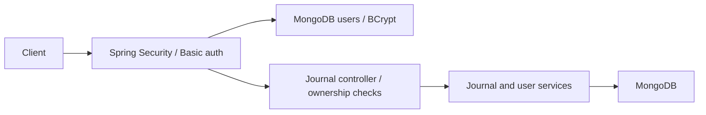

# Journal Backend

[](https://github.com/amrit2603/journalApp_backend/actions/workflows/ci.yml)

A local REST API for personal journal entries. Each request authenticates against a MongoDB user with BCrypt credentials; entry reads, updates and deletes check ownership before querying or changing a journal record.

**Stack:** Java 17 · Spring Boot 4 · Spring Security · Spring Data MongoDB · Lombok · Maven · JUnit/Mockito

## What works

- HTTP Basic authentication against stored user accounts; no generated Spring development account.
- Create, list, read, update and delete the authenticated user's journal entries.
- Ownership checks return `404` for another user's entry; unauthenticated requests return `401`.
- Required titles (max 200 characters), content bounds (10,000 characters), invalid-ID rejection and stable hex-string IDs in responses.
- Opt-in local demo-account setup which never resets an existing account.
- Automated authentication and ownership tests using real Spring Security filters with mocked repositories.

## Quick start on Windows

Prerequisites: JDK 17+ and a local MongoDB instance listening on port 27017. Maven is downloaded by the wrapper. Do not point the demo at an important database.

```powershell
git clone https://github.com/amrit2603/journalApp_backend.git
cd journalApp_backend
.\mvnw.cmd -B verify

$env:JOURNAL_MONGODB_URI = 'mongodb://localhost:27017/journal_demo'
$env:SPRING_PROFILES_ACTIVE = 'demo'
$env:JOURNAL_DEMO_USERNAME = 'demo'
$env:JOURNAL_DEMO_PASSWORD = Read-Host 'Choose a demo password (12-72 characters)'
.\mvnw.cmd spring-boot:run
```

On macOS/Linux use `./mvnw` (or `bash mvnw`) and `export NAME=value` for the same variables. The API binds to **127.0.0.1:8080**. The `demo` profile creates the requested user only if the username does not already exist. It never changes an existing user's password. Without that profile, existing database accounts are used and no account is created automatically.

## Try the API

In a second PowerShell terminal, `curl.exe -u demo` prompts for the password, so it does not need to be pasted into a command. Use a disposable note:

```powershell
# List: initially []
curl.exe -u demo http://127.0.0.1:8080/journal

# Create: the JSON response contains the new entry's hex-string id.
'{"title":"First note","content":"Today I practiced Spring Security."}' | Set-Content -Encoding ascii note.json
curl.exe -u demo -H 'Content-Type: application/json' --data-binary '@note.json' http://127.0.0.1:8080/journal

# Replace ENTRY_ID with the response id.
curl.exe -u demo http://127.0.0.1:8080/journal/id/ENTRY_ID
curl.exe -u demo -X PUT -H 'Content-Type: application/json' --data-binary '@note.json' http://127.0.0.1:8080/journal/id/ENTRY_ID
curl.exe -u demo -X DELETE http://127.0.0.1:8080/journal/id/ENTRY_ID
```

Copy the sample JSON into a file and use `curl` on macOS/Linux. Keep personal journal data out of source control.

| Method | Endpoint | Success |
| --- | --- | --- |
| GET | `/journal` | `200`, array (including empty) |
| POST | `/journal` | `201`, created entry |
| GET | `/journal/id/{id}` | `200`, owned entry |
| PUT | `/journal/id/{id}` | `200`, replacement title/content |
| DELETE | `/journal/id/{id}` | `204` |

An entry response contains `id`, `title`, `content` and `date`. Title/content are the only accepted write fields; the server assigns the ID and creation date. This release changes the old empty-list `404` to `200 []` and uses explicit response IDs rather than MongoDB's internal JSON representation.

## Architecture and decisions



- Spring Security's [UserDetailsService](https://docs.spring.io/spring-security/reference/servlet/authentication/passwords/user-details-service.html) connects authentication to existing MongoDB users. Password hashes never appear in entry responses.
- Ownership comes from the authenticated username and the user's entry references. A supplied journal ID never grants access by itself.
- DTOs keep incoming IDs, dates and user references out of create/update operations.
- A local `demo` profile makes the project reproducible without adding public registration or a frontend.
- The project retains its tutorial-derived `net.engineeringdigest` package naming. It is a learning implementation, with subsequent security, testing and documentation work visible in Git history.

## Verification and limits

`mvnw verify` runs the application-context check and MockMvc tests for valid/invalid Basic credentials, empty lists, validation, entry creation and cross-user read/update/delete rejection. Persistence is mocked; these checks do not establish live MongoDB atomicity, load capacity or production security.

This is a **localhost demonstration**. HTTP Basic credentials need HTTPS on a real deployment. CSRF is disabled for this non-browser API; browser credential/cookie flows need a separate CSRF design. Public registration, rate limiting, password recovery, pagination and a production deployment are not included. Linking an entry document and a user document is not atomic on a standalone MongoDB server; the existing `@Transactional` annotation alone does not enable multi-document transactions. Do not expose this API publicly as-is or store sensitive journals in the demo.
